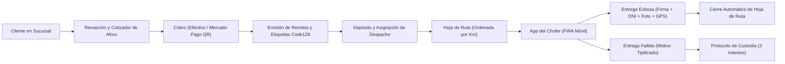
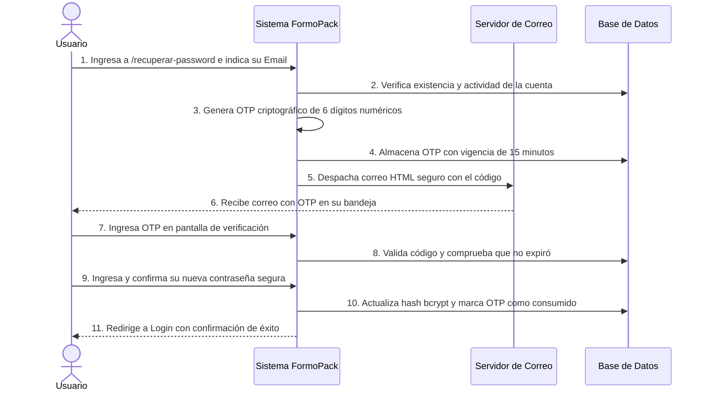
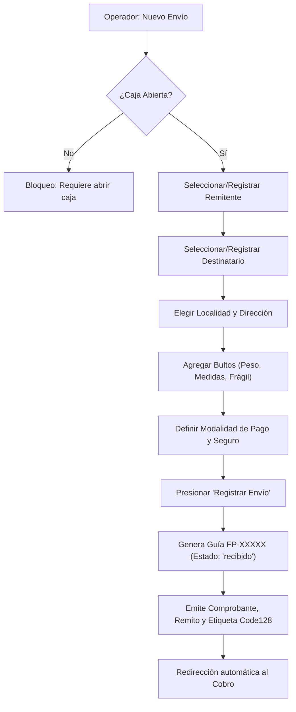
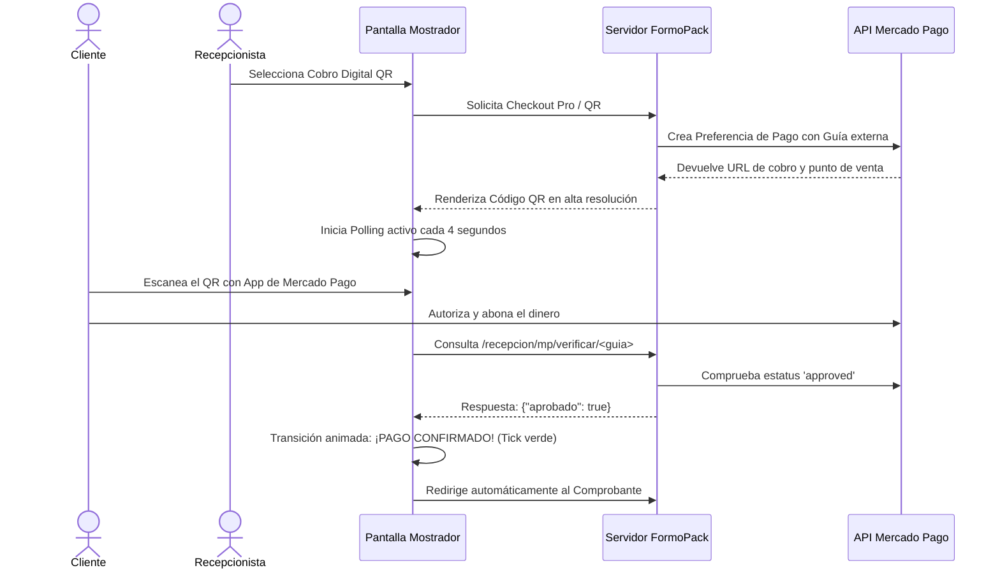
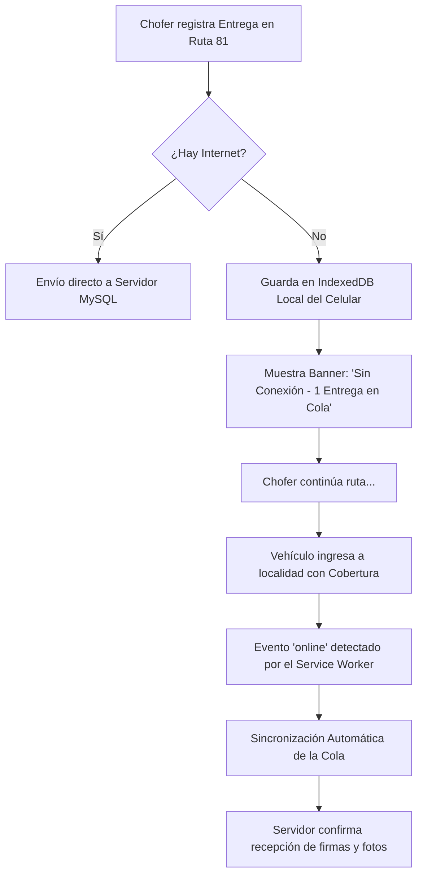
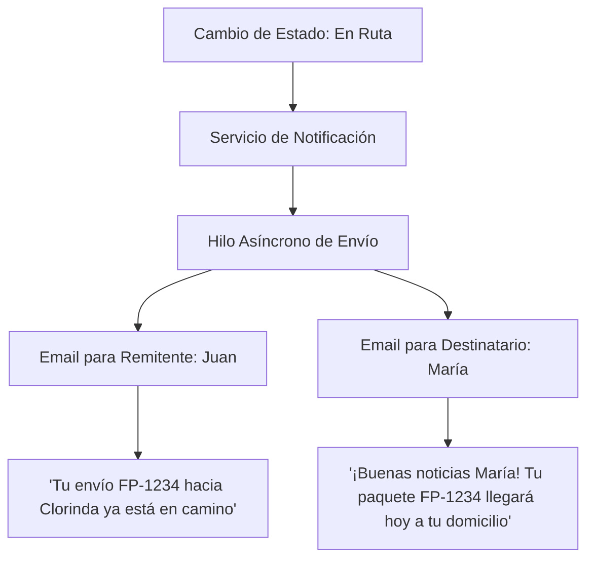
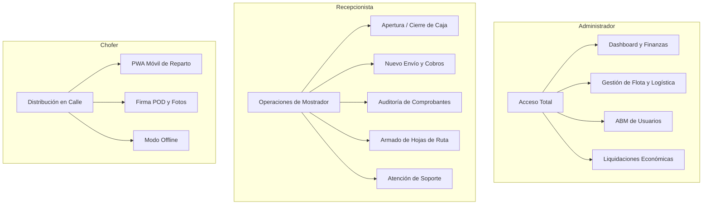
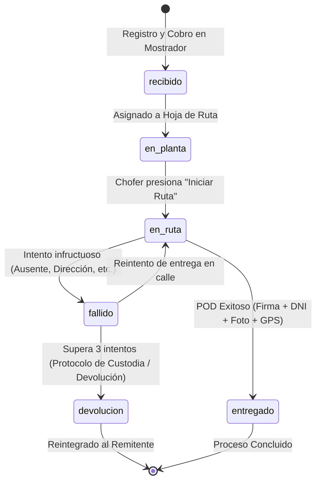

# MANUAL DE USUARIO 22 10 26

# FormoPack Express
### Sistema Integral de Gestión Logística, Distribución y Facturación
**Autores:** Máximo Gómez, Máximo Gavilán, Julián González  
**Versión del Sistema:** 3.5 Enterprise  
**Fecha de Edición:** 22 de Octubre de 2026  
**Ámbito de Aplicación:** Plataforma Corporativa Web, PWA Móvil de Reparto y Portal Público de Clientes  

---

## Control de Versiones del Documento

| Versión | Fecha | Resumen de Modificaciones Principales | Autores |
|---|---|---|---|
| **1.0** | 02/09/2026 | Documentación inicial de módulos de Mostrador, Registro de Envíos y Caja básica. | M. Gómez, M. Gavilán, J. González |
| **2.0** | 17/09/2026 | Incorporación de la plataforma PWA del Chofer, Firma Digital (POD), Modo Offline y Gestión de Flota. | M. Gómez, M. Gavilán, J. González |
| **3.0** | 30/09/2026 | Integración de Liquidaciones de Choferes, Dashboard Gerencial y Alertas SMTP. | M. Gómez, M. Gavilán, J. González |
| **3.5** | 22/10/2026 | Actualización total: Landing Page, Recuperación OTP de Contraseña, Cobro en vivo Mercado Pago, Comprobantes de Servicios, Cierre Automático de Hoja de Ruta, Notificaciones Duales Asíncronas, Mapa Logístico Leaflet en Vivo, Protocolo de Custodia (3 intentos), Chat de Soporte en Tiempo Real, Rate Limiting y CSRF. | M. Gómez, M. Gavilán, J. González |

---

# ÍNDICE GENERAL

1. **Introducción y Arquitectura de la Plataforma**
   - 1.1 Propósito y Alcance del Sistema
   - 1.2 Módulos Funcionales Implementados
   - 1.3 Requisitos Técnicos y Entorno de Acceso
2. **Acceso al Sistema y Seguridad de Cuentas**
   - 2.1 Landing Page Institucional
   - 2.2 Modal de Autenticación Centralizada
   - 2.3 Medidas de Seguridad y Protección contra Ataques (Rate Limiting y CSRF)
   - 2.4 Recuperación Segura de Contraseñas mediante Código OTP
   - 2.5 Cierre de Sesión Seguro
3. **Estructura General de la Interfaz y Navegación**
   - 3.1 Barra de Navegación Lateral Dinámica por Rol
   - 3.2 Barra Superior de Estado y Perfil de Usuario
   - 3.3 Micro-interacciones y Animaciones Visuales
4. **Módulo de Recepción y Facturación en Mostrador**
   - 4.1 Apertura y Control del Turno de Caja
   - 4.2 Registro y Búsqueda Inteligente de Clientes
   - 4.3 Cotizador Tarifario por Aforo y Regla Multibulto
   - 4.4 Declaración de Valores y Cobertura de Seguros
   - 4.5 Alta y Registro Formal de Envíos
   - 4.6 Cobro en Efectivo con Cálculo Automático de Vuelto
   - 4.7 Cobro Digital con QR y Verificación en Vivo de Mercado Pago
   - 4.8 Modalidad de Cobro en Cuenta Corriente
   - 4.9 Cierre de Turno de Caja y Conciliación Económica
5. **Gestión y Emisión de Documentación Operativa**
   - 5.1 Comprobantes Internos de Recepción y Servicio
   - 5.2 Remitos Triplicados en Formato PDF
   - 5.3 Etiquetas Térmicas con Código de Barras Code128
   - 5.4 Repositorio, Búsqueda y Auditoría de Comprobantes de Servicios
6. **Módulo de Logística y Planificación de Despachos**
   - 6.1 Gestión y Estados de la Flota Vehicular
   - 6.2 Planificación y Armado de Hojas de Ruta
   - 6.3 Algoritmo de Ruteo Optimizado por Distancia Kilométrica
   - 6.4 Emisión de Manifiestos de Carga
   - 6.5 Cierre Automático de Despacho y Liberación de Unidades
7. **Monitoreo Geográfico y Mapa Logístico Interactivo**
   - 7.1 Visualización Geoespacial de la Flota con Leaflet
   - 7.2 Transmisión y Trazabilidad GPS en Tiempo Real
   - 7.3 Filtros por Estado de Vehículo y Ajuste Dinámico de Vista
8. **Plataforma Móvil para Choferes (PWA)**
   - 8.1 Arquitectura Mobile-First e Instalación en Dispositivos Móviles
   - 8.2 Manifiesto de Entregas del Día y Progreso de Recorrido
   - 8.3 Inicio Formal de la Hoja de Ruta
   - 8.4 Registro de Prueba de Entrega (POD): Firma Digital, DNI y Foto con Validación de Magic Bytes
   - 8.5 Tipificación de Entregas Fallidas y Gestión de Reintentos
   - 8.6 Operación en Zonas sin Cobertura: Almacenamiento Offline en IndexedDB y Sincronización Automática
   - 8.7 Compartir Ubicación en Tiempo Real
9. **Panel de Control y Dashboard Gerencial**
   - 9.1 Indicadores Clave de Desempeño (KPIs) Operativos
   - 9.2 Gráfico Histórico Continuo de Evolución Semanal
   - 9.3 Detección Proactiva de Alertas Operativas Críticas y Preventivas
   - 9.4 Buscador Global de Envíos y Modal de Actualización Auditada de Estados
10. **Portal Público de Consulta y Seguimiento (Tracking)**
    - 10.1 Búsqueda y Validación de Guía de Envío
    - 10.2 Línea de Tiempo Interactiva con Iconografía Semántica
    - 10.3 Protocolo de Custodia tras Tres Intentos Fallidos y Credencial de Retiro
    - 10.4 Herramientas de Difusión: Compartir Estado por WhatsApp y SMS
    - 10.5 Auto-refresco Periódico en Pantalla
11. **Servicio de Notificaciones Duales por Correo Electrónico**
    - 11.1 Arquitectura Asíncrona Desacoplada
    - 11.2 Segmentación de Mensajes: Remitente vs. Destinatario
    - 11.3 Plantillas de Correo HTML Responsivas
    - 11.4 Disparo Manual de Alertas Operativas Gerenciales
12. **Canal de Soporte al Cliente y Chat en Vivo**
    - 12.1 Inicio de Consulta desde el Portal de Seguimiento
    - 12.2 Panel de Gestión de Chats para Administradores y Recepcionistas
    - 12.3 Asignación Exclusiva de Conversaciones por Operador
    - 12.4 Sala de Conversación en Vivo y Polling de Mensajes
    - 12.5 Finalización y Limpieza Automática de Conversaciones
13. **Módulo de Administración de Personal y Seguridad (RBAC)**
    - 13.1 Políticas de Roles y Privilegios en el Sistema
    - 13.2 Alta de Nuevos Usuarios con Validación Estricta de Credenciales
    - 13.3 Activación, Desactivación y Prevención de Auto-bloqueo
14. **Liquidaciones y Cierre Económico de Choferes**
    - 14.1 Propósito y Métricas de Rendimiento por Repartidor
    - 14.2 Resumen General y Análisis de Efectividad con Barras de Progreso
    - 14.3 Liquidación Individual Detallada por Hoja de Ruta y Distancia Recorrida
15. **Exportación de Datos y Reportes Analíticos**
    - 15.1 Descarga de Reportes de Envíos en Formato CSV
    - 15.2 Exportación de Comprobantes de Servicios
    - 15.3 Integración con Hojas de Cálculo
16. **Guía de Solución de Problemas y Preguntas Frecuentes**
    - 16.1 Respuestas a Incidentes Operativos Habituales
    - 16.2 Diagnóstico de Conectividad, Base de Datos y Sistema de Migraciones
17. **Glosario de Estados y Terminología Logística**

---

# 1. INTRODUCCIÓN Y ARQUITECTURA DE LA PLATAFORMA

## 1.1 Propósito y Alcance del Sistema

**FormoPack Express** es una plataforma integral de gestión logística, operativa y comercial diseñada específicamente para optimizar la cadena de distribución de paquetería y encomiendas en la provincia de Formosa y corredores de transporte vinculados (Ruta Nacional 81, Ruta Nacional 11).

El sistema unifica en una única infraestructura digital todo el ciclo de vida de un envío:
1. **Recepción en mostrador:** Alta de remitentes y destinatarios, cubicaje automático mediante regla de aforo, aplicación de seguros sobre valor declarado y cálculo de tarifas con descuentos multibulto.
2. **Facturación y cobranza:** Registro de pagos en efectivo con cálculo de vuelto o mediante cobros digitales con códigos QR interoperables y pasarela Mercado Pago en tiempo real.
3. **Logística y despacho:** Agrupamiento inteligente de bultos en hojas de ruta optimizadas por cercanía kilométrica, control estricto de capacidad de carga de los vehículos y monitoreo geográfico en vivo sobre mapa interactivo.
4. **Distribución de última milla:** Aplicación web progresiva (PWA) para los choferes en calle, con registro de Prueba de Entrega (POD), firma digital táctil, captura de evidencia fotográfica con validación de seguridad, geolocalización satelital y funcionamiento ininterrumpido sin conectividad a Internet.
5. **Atención y transparencia hacia el cliente:** Portal de seguimiento público en tiempo real, notificaciones automáticas y personalizadas por correo electrónico para remitente y destinatario, y canal de chat de soporte en vivo integrado.
6. **Auditoría y control gerencial:** Dashboard de mando con indicadores en tiempo real, prevención de fraudes, conciliación de caja al centavo, liquidación económica del rendimiento de choferes y trazabilidad inalterable de cada evento logístico.



## 1.2 Módulos Funcionales Implementados

La arquitectura de FormoPack Express se encuentra modularizada de acuerdo con el principio de separación de responsabilidades y control de acceso basado en roles (RBAC):

| Módulo | Descripción Funcional | Roles con Acceso |
|---|---|---|
| **Seguridad y Acceso** | Autenticación de usuarios, protección ante ataques de fuerza bruta (Rate Limiting), control CSRF y recuperación de contraseñas mediante códigos OTP temporales. | Todos / Público |
| **Turno de Caja** | Control de apertura y cierre de caja por operador, arqueo de fondos, balance de efectivo y conciliación contra acreditaciones digitales. | Administrador, Recepcionista |
| **Recepción y Envíos** | Gestión de clientes, cotizador con peso volumétrico y reglas multibulto, registro de paquetes y emisión instantánea de remitos triplicados y etiquetas térmicas. | Administrador, Recepcionista |
| **Auditoría de Comprobantes** | Repositorio centralizado de comprobantes de servicio emitidos, búsqueda avanzada por número de guía o cliente, reimpresión y exportación CSV. | Administrador, Recepcionista |
| **Logística y Flota** | Mantenimiento de unidades vehiculares, armado de manifiestos con cálculo de carga máxima y ruteo automático por distancia kilométrica. | Administrador, Recepcionista |
| **Monitoreo en Mapa** | Visualización geoespacial con Leaflet de la ubicación en tiempo real de choferes y vehículos en las rutas de la provincia. | Administrador |
| **Plataforma del Chofer** | PWA móvil-first con lista de entregas, firma en pantalla táctil, validación fotográfica, telemetría GPS y modo offline con IndexedDB. | Chofer |
| **Dashboard Gerencial** | Panel de control centralizado con métricas de recaudación, gráfico histórico de 7 días, alertas operativas y actualización auditada de envíos. | Administrador, Recepcionista |
| **Seguimiento (Tracking)** | Portal de rastreo público con timeline cronológico, credencial digital de custodia tras 3 visitas fallidas y botones para compartir en redes. | Público / Todos |
| **Canal de Soporte en Vivo** | Chat interactivo de atención al cliente con asignación individual de operadores y cierre seguro de sesiones. | Administrador, Recepcionista, Público |
| **Notificaciones Duales** | Servicio de mensajería asíncrono con correos HTML personalizados para remitente y destinatario según el cambio de estado. | Automatismo del Sistema |
| **Gestión de Personal** | Administración de cuentas de usuarios, asignación de roles, verificación de contraseñas seguras y desactivación preventiva. | Exclusivo Administrador |
| **Liquidaciones** | Balance económico de choferes, cómputo de entregas completadas, índice de efectividad y estimación de distancias recorridas. | Exclusivo Administrador |

## 1.3 Requisitos Técnicos y Entorno de Acceso

FormoPack Express es una plataforma web basada en estándares modernos (HTML5, CSS3, JavaScript ES6+, Python Flask y MySQL).

### Para Estaciones de Trabajo de Sucursal y Gerencia (Mostrador / Oficina)
- **Navegadores recomendados:** Google Chrome (versión 110+), Mozilla Firefox (versión 115+), Microsoft Edge (versión 110+), Safari (versión 16+).
- **Resolución de pantalla sugerida:** 1366 × 768 píxeles o superior.
- **Conectividad:** Conexión a Internet de banda ancha estable (cableada o Wi-Fi).
- **Periféricos opcionales:** Lector de código de barras USB/Bluetooth (emulación de teclado), impresora láser/tinta formato A4 (para comprobantes y remitos), e impresora térmica de etiquetas de 100 × 150 mm (para etiquetas Code128).

### Para Dispositivos Móviles de Choferes (Distribución en Calle)
- **Sistema Operativo:** Android 9.0 o superior; iOS 14.0 o superior.
- **Navegador móvil:** Google Chrome Mobile o Safari Mobile.
- **Hardware requerido:** Pantalla táctil capacitiva (para firma digital), cámara fotográfica trasera funcional y receptor GPS con permisos de ubicación habilitados.
- **Almacenamiento local:** Al menos 50 MB de memoria disponible en el navegador para la base de datos local IndexedDB y archivos en caché del Service Worker.
- **Conectividad:** Conexión de datos móviles 3G/4G/5G para sincronización en tiempo real. En áreas sin señal, el sistema entra en modo offline de forma automática.

---

# 2. ACCESO AL SISTEMA Y SEGURIDAD DE CUENTAS

## 2.1 Landing Page Institucional

Al acceder a la dirección raíz del servidor (`/`), los usuarios que no posean una sesión activa son recibidos por la **Landing Page Corporativa** de FormoPack Express.

Esta pantalla presenta una vista moderna y atractiva de la empresa con los siguientes elementos:
- **Barra de cabecera:** Isologotipo institucional, enlaces de navegación directa y botón de **"Iniciar Sesión"**.
- **Sección Hero:** Mensaje de bienvenida corporativo, botón de acceso rápido al formulario de autenticación y botón directo para **"Consultar Envío"** (acceso sin credenciales al módulo de Tracking).
- **Sección de Características:** Cuadrícula de tarjetas interactivas que destacan las capacidades operativas:
  - *Registro Inteligente de Envíos:* Generación automática de guías y reglas de cubicaje.
  - *Ruteo Dinámico:* Asignación de vehículos y ordenamiento por distancia.
  - *Pasarelas de Cobro:* Integración de efectivo y pagos QR con verificación en vivo.
  - *Plataforma Móvil PWA:* Firma en pantalla, captura de fotos y funcionamiento offline.
- **Banda de Métricas e Indicadores:** Estadísticas operativas destacadas (*100% Digital, Control RBAC, Estado en Tiempo Real*).
- **Pie de Página Institucional:** Enlace a políticas de servicio, canal de soporte y copyright.

## 2.2 Modal de Autenticación Centralizada

Al presionar el botón **"Iniciar Sesión"** en la Landing Page, o al acceder a `/login`, se despliega una ventana modal interactiva con fondo oscuro difuminado y animación suave de entrada.

### Campos Requeridos para el Inicio de Sesión

| Campo | Tipo | Restricciones | Descripción |
|---|---|---|---|
| **Correo Institucional** | Email | Máximo 100 caracteres, formato estándar `@`. | Correo electrónico corporativo con el que fue dado de alta el empleado en la base de datos. |
| **Contraseña** | Contraseña | Mínimo 8 caracteres, máximo 72 caracteres. | Clave secreta personal del operador. |

> [!IMPORTANT]
> **Mensaje de Seguridad Ofuscado:** Si los datos ingresados no coinciden o el correo no existe, el sistema reportará: *"Credenciales inválidas. Por favor verifique su correo y contraseña"*. Bajo ninguna circunstancia el sistema revelará si la falla provino del correo inexistente o de la contraseña errónea, evitando técnicas de enumeración de cuentas.

### Cuentas de Demostración del Sistema

| Rol Asignado | Correo Electrónico | Contraseña | Destino Inicial Post-Login |
|---|---|---|---|
| **Administrador** | `admin@formopack.com` | `admin123` | Panel de Control (`/admin/dashboard`) |
| **Recepcionista** | `recepcion@formopack.com` | `recep456` | Turno de Caja (`/recepcion/caja`) |
| **Chofer** | `chofer@formopack.com` | `chofer789` | Panel Móvil de Reparto (`/chofer/panel`) |

## 2.3 Medidas de Seguridad y Protección contra Ataques

La plataforma incorpora salvaguardas arquitectónicas de nivel bancario para preservar la integridad operativa:

1. **Limitador de Tasa (Rate Limiting en Login):**
   - El sistema monitorea los intentos de autenticación por dirección IP de origen.
   - Si se registran más de **10 intentos fallidos en una ventana de 60 segundos**, la IP queda automáticamente bloqueada de manera temporal durante un minuto, impidiendo ataques de fuerza bruta automatizados.
2. **Protección Anti-CSRF (Cross-Site Request Forgery):**
   - Todos los formularios de la aplicación integran un token criptográfico oculto e irrepetible. Cualquier solicitud POST sin token válido es rechazada con un error HTTP 400.
3. **Cifrado de Credenciales:**
   - Las contraseñas jamás se almacenan en texto plano. Se procesan mediante el algoritmo `bcrypt` con factores de trabajo y sales dinámicas.
4. **Validación de Usuarios Activos:**
   - Si un usuario se encuentra en estado *Inactivo* (desactivado por el Administrador), no podrá ingresar aunque ingrese su clave legítima, mostrándose la alerta: *"Su cuenta de usuario se encuentra temporalmente desactivada. Contacte al administrador"*.

## 2.4 Recuperación Segura de Contraseñas mediante Código OTP

En caso de que un operador o chofer olvide sus credenciales de acceso, el sistema provee un mecanismo automatizado de restablecimiento basado en **Códigos de Un Solo Uso (OTP - One Time Password)** transmitidos por correo electrónico.



### Procedimiento Paso a Paso de Recuperación

1. **Solicitud del Código:**
   - En el modal de login, hacer clic en el enlace **"¿Olvidó su contraseña?"** (o dirigirse a `/recuperar-password`).
   - Ingresar el correo electrónico corporativo asociado a la cuenta.
   - Presionar **"Enviar Código de Seguridad"**.
   - Por razones de confidencialidad, el sistema confirmará que el código ha sido despachado incluso si el correo no estuviera registrado, para evitar fugas de información.
2. **Recepción del Correo:**
   - El usuario recibirá en su bandeja de entrada un correo con asunto: *Código de Recuperación de Contraseña — FormoPack Express*.
   - El código está compuesto por **6 dígitos numéricos** (ej. `492815`) y cuenta con una vigencia estricta de **15 minutos**.
3. **Validación del OTP:**
   - En la pantalla de verificación (`/recuperar-password/verificar`), ingresar los 6 dígitos.
   - Si el código ingresado expiró o es erróneo, el sistema mostrará la advertencia correspondiente y no permitirá avanzar.
4. **Establecimiento de Nueva Contraseña:**
   - Una vez validado el OTP, el sistema habilita el formulario de cambio de clave (`/recuperar-password/nueva`).
   - **Reglas de complejidad exigidas:**
     - Longitud mínima de **8 caracteres**.
     - Debe combinar al menos una **letra** (mayúscula o minúscula) y al menos un **número**.
     - No puede coincidir con valores triviales.
   - Confirmar la nueva contraseña. Al procesarse, el código OTP queda invalidado para evitar reutilizaciones y el usuario es redirigido al login para iniciar sesión de inmediato.

## 2.5 Cierre de Sesión Seguro

En cualquier momento de la jornada, el usuario puede finalizar su sesión haciendo clic en el botón **"Cerrar Sesión"** ubicado en el extremo derecho del topbar (o en la barra móvil del chofer). Esto destruye de inmediato la cookie de sesión cifrada del servidor, impidiendo que terceros puedan acceder al historial o realizar transacciones no autorizadas.

---

# 3. ESTRUCTURA GENERAL DE LA INTERFAZ Y NAVEGACIÓN

## 3.1 Barra de Navegación Lateral (Sidebar) Dinámica por Rol

El entorno de trabajo para el personal administrativo y de mostrador cuenta con una barra de navegación fija a la izquierda (`#0a192f`), la cual adapta su menú según los privilegios del usuario autenticado:

```
[ FormoPack Express ]
----------------------------------
OPERACIONES
  ├── [ + ] Nuevo Envío (Recepcionista / Admin)
  └── [ $ ] Turno de Caja (Recepcionista / Admin)
ADMINISTRACIÓN
  ├── [ 📊 ] Panel de Control (Dashboard)
  ├── [ 🧾 ] Comprobantes de Servicios (Historial & Reimpresión)
  ├── [ 🚚 ] Logística y Despachos (Flota & Hojas de Ruta)
  ├── [ 🗺️ ] Mapa de Unidades (Monitoreo en Vivo)
  ├── [ 👥 ] Gestión de Usuarios (Exclusivo Administrador)
  └── [ 📈 ] Liquidaciones de Choferes (Exclusivo Administrador)
SOPORTE
  └── [ 💬 ] Chat con Clientes (Atención de Consultas en Vivo)
CONSULTAS PÚBLICAS
  └── [ 🔍 ] Seguimiento de Envíos (Tracking)
----------------------------------
[Avatar] Usuario Logueado (Rol)
```

- **Sección Activa Destacada:** El enlace correspondiente a la vista en la que se encuentra el usuario se resalta con un borde lateral azul brillante (`#4da3ff`) y fondo iluminado.
- **Modo Colapsable en Dispositivos Móviles:** En pantallas con ancho inferior a 768 píxeles, el sidebar se oculta automáticamente. Puede desplegarse mediante el botón flotante de menú (hamburguesa) en la parte superior izquierda.

## 3.2 Barra Superior de Estado y Perfil de Usuario (Topbar)

En el margen superior de cada pantalla se encuentra el topbar blanco institucional, el cual suministra información de contexto en todo momento:
- **Título de la Vista Actual:** Muestra la sección operativa abierta (ej. *Módulo de Recepción - Nuevo Envío*).
- **Indicador de Usuario y Rol:** Presenta un avatar circular con la inicial del operador, su nombre completo y una insignia semántica que identifica su rol (*Administrador* en color coral/rojo, *Recepcionista* en azul celeste).
- **Acceso Directo a Desconexión:** Botón de Logout directo para salir rápidamente de la terminal.

## 3.3 Micro-interacciones y Animaciones Visuales

La interfaz utiliza la librería **AOS.js (Animate On Scroll)** y transiciones CSS fluidas para una experiencia visual de alta calidad:
- **Transición de Pantallas:** Los paneles principales entran suavemente hacia arriba (`fade-up`), otorgando dinamismo a la navegación.
- **Elevación de Tarjetas:** Al pasar el cursor sobre las tarjetas de métricas o despachos, estas experimentan un leve desplazamiento hacia arriba (`translateY(-2px)`) y un incremento en su sombra.
- **Alertas Auto-desvanecibles:** Los mensajes informativos y de éxito (Flash Alerts) se ocultan automáticamente tras **5 segundos** mediante una transición gradual de opacidad, evitando la saturación del espacio visual del operador.

---

# 4. MÓDULO DE RECEPCIÓN Y FACTURACIÓN EN MOSTRADOR

## 4.1 Apertura y Control del Turno de Caja

**Ruta en Sistema:** `/recepcion/caja`  
**Roles Autorizados:** Administrador, Recepcionista  

El turno de caja es el prerrequisito indispensable para iniciar las operaciones del día. Ningún envío puede ser cobrado si el recepcionista no posee un turno de caja en estado **"abierto"**.

### Procedimiento de Apertura de Caja
1. Navegar a **Turno de Caja** en el menú lateral.
2. Si no hay turno abierto, el sistema presenta el formulario de apertura.
3. Ingresar el **Saldo Inicial en Efectivo** (monto físico en billetes/monedas con el que se inicia la jornada).
   - Rango admitido: `$0.00` hasta `$999,999.00`.
   - Puede ser `0.00` si se comienza sin cambio.
4. Presionar el botón **"Abrir Turno de Caja"**.
5. El sistema sella la hora exacta de apertura y asocia al usuario a dicho turno.

> [!NOTE]
> Solo se permite **un turno de caja abierto por recepcionista simultáneamente**. Si el operador ya posee una caja abierta, el sistema mostrará directamente el panel de estado actual y el acumulado en curso.

---

## 4.2 Registro y Búsqueda Inteligente de Clientes

**Rutas en Sistema:** `/recepcion/nuevo_cliente` | `/recepcion/buscar_cliente`  
**Roles Autorizados:** Administrador, Recepcionista  

Para generar un envío, es obligatorio que tanto el **Remitente** (quien envía) como el **Destinatario** (quien recibe) se encuentren registrados en la base de datos de clientes.

### Formulario de Alta de Cliente

| Nombre del Campo | Tipo de Dato | Carácter | Validaciones y Restricciones |
|---|---|---|---|
| **DNI / CUIT** | Numérico | Obligatorio | Entre 7 y 15 dígitos continuos. Sin puntos ni guiones. No admite duplicados. |
| **Nombre Completo** | Alfanumérico | Obligatorio | Solo letras, espacios, acentos y guiones. Entre 3 y 100 caracteres. |
| **Teléfono de Contacto** | Numérico | Obligatorio | Entre 7 y 20 dígitos. Clave para contacto telefónico o WhatsApp de reparto. |
| **Correo Electrónico** | Email | Opcional | Formato válido (`usuario@dominio.com`). Requerido para recibir notificaciones automáticas de tracking. |

### Búsqueda Inteligente por DNI (AJAX)
En el formulario de creación de envíos no es necesario cargar al cliente manualmente si ya fue registrado previamente:
- El operador escribe el DNI en el buscador de remitente o destinatario.
- A partir del tercer dígito ingresado, el sistema consulta en segundo plano mediante AJAX y autocompleta el nombre y datos de contacto de forma inmediata, acelerando notablemente la atención en mostrador.

---

## 4.3 Cotizador Tarifario por Aforo y Regla Multibulto

**Ruta en Sistema:** `/recepcion/cotizador`  
**Roles Autorizados:** Administrador, Recepcionista  

El cotizador permite calcular el costo exacto de un despacho antes de emitir la guía formal, permitiendo al cliente conocer el precio final antes de confirmar la operación.

### Fórmula de Aforo (Peso Volumétrico vs. Peso Real)
El transporte de paquetería se ve condicionado tanto por la masa del paquete como por el volumen que ocupa en la bodega del vehículo. Por ello, el sistema aplica la **Regla de Aforo Estándar IATA**:

$$\text{Peso Volumétrico (kg)} = \frac{\text{Largo (cm)} \times \text{Ancho (cm)} \times \text{Alto (cm)}}{5000}$$

El sistema evalúa cada bulto y selecciona automáticamente el **Peso Facturable**:

$$\text{Peso Facturable} = \max(\text{Peso Real}, \text{Peso Volumétrico})$$

### Regla Comercial Multibulto (Descuento Progresivo)
Cuando un envío consta de dos o más paquetes remitidos por el mismo cliente al mismo destino:
- **Primer bulto:** Se tarifa al **100%** de la cotización base según peso facturable y distancia a la localidad.
- **Segundo bulto y posteriores:** Aplican un **descuento automático del 50%** sobre la tarifa base individual de cada bulto adicional.

### Recargo por Mercadería Frágil
Si se tilda la casilla **"Frágil"** en un bulto (por ejemplo: vajilla, cristalería, tecnología sensible), se aplica un recargo del **10%** sobre la tarifa de dicho bulto para contemplar el embalaje especial y manipulación cuidadosa en depósito y transporte.

---

## 4.4 Declaración de Valores y Cobertura de Seguros

El sistema salvaguarda la responsabilidad patrimonial del transporte exigiendo la declaración del valor de la mercadería:
- **Cobertura Estándar:** Cada seguro incluye una cobertura base sin costo extra (ej. hasta `$50,000.00`).
- **Seguro por Exceso de Valor Declarado:** Si el cliente declara un valor superior a la cobertura base de la póliza seleccionada, el cotizador aplica automáticamente un porcentaje adicional (ej. **1.5%** sobre el monto excedente), el cual se suma al importe total del envío.

---

## 4.5 Alta y Registro Formal de Envíos

**Ruta en Sistema:** `/recepcion/nuevo_envio`  
**Roles Autorizados:** Administrador, Recepcionista  

Esta pantalla consolida toda la información de la operación y culmina con la generación del número de guía irrepetible (formato `FP-XXXXXXXX`).



### Campos y Parámetros del Formulario de Envío

1. **Remitente:** DNI o búsqueda por nombre del remitente registrado.
2. **Destinatario:** DNI o búsqueda del cliente receptor.
3. **Localidad de Destino:** Menú desplegable con las ciudades de la provincia (Formosa Capital, Clorinda, El Colorado, Pirané, Las Lomitas, Ibarreta, Fontana, Ingeniero Juárez, etc.). Cada localidad tiene asociada su distancia en kilómetros y tarifa base.
4. **Dirección de Destino:** Calle, número, piso, departamento y barrio. Mínimo 5 caracteres, máximo 200.
5. **Valor Declarado ($):** Monto estimado del contenido del paquete (entre `$0.00` y `$9,999,999.00`).
6. **Tipo de Seguro:** Póliza a aplicar (Básica, Total, Frágil).
7. **Modalidad de Pago:**
   - `Efectivo`: Se cobrará en mostrador al despachar.
   - `Digital`: Se cobrará mediante billetera virtual o QR de Mercado Pago.
   - `Cuenta Corriente`: Para clientes corporativos con crédito habilitado.
8. **Detalle de Bultos Dinámicos:**
   - Botón **"+ Agregar otro bulto"**: Permite añadir la cantidad deseada de bultos.
   - Cada bulto registra su *Peso Real (kg)*, *Peso Volumétrico (kg)* y tilde de *Frágil*.

Al hacer clic en **"Registrar Envío"**, el sistema genera la guía, cambia el estado a **`recibido`** y redirige inmediatamente al operador a la pantalla de cobro.

---

## 4.6 Cobro en Efectivo con Cálculo Automático de Vuelto

**Ruta en Sistema:** `/recepcion/cobrar/<nro_guia>`  

Si el envío fue fijado con pago en mostrador:
1. La pantalla exhibe el resumen del envío: número de guía, remitente, destinatario, destino y el **Total a Cobrar**.
2. Al seleccionar la pestaña **Efectivo**, se ingresa en el campo **"Monto Entregado"** el dinero recibido del cliente.
3. El sistema calcula en tiempo real e indica en pantalla el **Vuelto exacto a reintegrar**.
4. Se hace clic en **"Confirmar Cobro en Efectivo"**.
5. El sistema registra el pago en la tabla `pagos`, asociándolo al `id_turno` de la caja abierta del operador, y avanza a la vista del Comprobante Oficial.

> [!TIP]
> **Protección contra Doble Cobro (Patrón PRG):** El sistema implementa la arquitectura *Post/Redirect/Get*. Si un operador intenta presionar la tecla F5 o recargar la página tras confirmar un cobro, el sistema detecta que la guía ya tiene un pago asentado y redirige al comprobante sin duplicar el ingreso contable.

---

## 4.7 Cobro Digital con QR y Verificación en Vivo de Mercado Pago

**Ruta en Sistema:** `/recepcion/cobrar/mp/<nro_guia>`  

Para agilizar los cobros electrónicos, FormoPack Express integra la pasarela **Mercado Pago** mediante generación dinámica de códigos QR y polling asíncrono en tiempo real.



### Dinámica del Proceso en Mostrador
1. El recepcionista selecciona **"Cobro Digital Mercado Pago"**.
2. La pantalla genera un código QR nítido con el monto exacto del envío y la referencia de la guía.
3. Un indicador visual animado informa: *"Esperando confirmación de pago..."*.
4. El cliente apunta con la cámara de su teléfono o abre Mercado Pago y paga en un instante.
5. El recepcionista **no necesita presionar ningún botón**: en cuanto Mercado Pago aprueba la operación, la pantalla oculta el QR, muestra una insignia verde gigante de **"¡Pago Confirmado!"** y redirige al comprobante de recepción en 2.5 segundos.

---

## 4.8 Modalidad de Cobro en Cuenta Corriente

Cuando un cliente habitual o empresa posee convenio crediticio:
- Se selecciona modalidad **Cuenta Corriente**.
- El envío queda registrado y habilitado para despacho sin requerir ingreso de efectivo en el mostrador.
- El cobro queda identificado para facturación periódica diferida contra el balance general de la cuenta del cliente.

---

## 4.9 Cierre de Turno de Caja y Conciliación Económica

Al concluir la jornada de atención al público, el recepcionista debe cerrar su turno:
1. Ingresar a **Turno de Caja** (`/recepcion/caja`).
2. El sistema despliega el **Arqueo Consolidado del Turno**:
   - **Saldo Inicial:** Efectivo de apertura.
   - **Ingresos Efectivo:** Suma exacta de cobros en billetes del turno.
   - **Total Físico Esperado en Cajón:** Saldo Inicial + Ingresos Efectivo (monto que debe estar físicamente en el mostrador).
   - **Ingresos Digitales (Mercado Pago / Transferencia):** Suma total acreditada en cuentas bancarias/virtuales vinculadas.
   - **Total Facturado General:** Sumatoria neta de la actividad del turno.
3. Presionar **"Cerrar Turno de Caja"** y confirmar en la ventana de advertencia.
4. El turno pasa a estado **`cerrado`**, impidiendo modificaciones ulteriores y generando el balance contable definitivo.

---

# 5. GESTIÓN Y EMISIÓN DE DOCUMENTACIÓN OPERATIVA

## 5.1 Comprobantes Internos de Recepción y Servicio

Al registrar o cobrar un envío, se habilita la pantalla de **Comprobante de Recepción** (`/recepcion/comprobante/<nro_guia>`).  
Este documento detalla:
- Número de Guía en tipografía de alto impacto.
- Fecha y hora exacta de emisión.
- Datos completos de Remitente (Nombre, DNI, Teléfono) y Destinatario.
- Destino y dirección de entrega.
- Resumen pormenorizado de bultos: pesos reales, pesos volumétricos y condición de fragilidad.
- Desglose económico: valor declarado, seguro aplicado, descuentos multibulto y total abonado.
- Botón **"Imprimir Comprobante"** para salida física inmediata.

## 5.2 Remitos Triplicados en Formato PDF

**Ruta en Sistema:** `/recepcion/remito/<nro_guia>/pdf`  

El sistema genera en un clic el **Remito Legal Triplicado**, maquetado profesionalmente según normativas comerciales de transporte terrestre:
- **Original:** Para el cliente Remitente (constancia de despacho).
- **Duplicado:** Para archivo administrativo de la empresa.
- **Triplicado:** Para el Chofer transportista (acompaña la carga en ruta y sirve como soporte físico para recabar la firma ológrafa del destinatario al momento de la entrega).

## 5.3 Etiquetas Térmicas con Código de Barras Code128

**Ruta en Sistema:** `/recepcion/etiqueta/<nro_guia>/pdf`  

Para identificar de forma inequívoca cada bulto en bodega y durante el traslado, el sistema genera etiquetas en formato estándar para impresoras térmicas (100 × 150 mm):
- **Código de Barras Code128:** Codifica el número de guía único para lectura veloz con pistola lectora láser en depósito.
- **Datos Visibles en la Etiqueta:** Número de guía en texto legible, localidad de destino destacada en gran tamaño, nombre del destinatario, teléfono de contacto y advertencia destacada en caso de bulto **"FRÁGIL"**.

## 5.4 Repositorio, Búsqueda y Auditoría de Comprobantes de Servicios

**Ruta en Sistema:** `/admin/comprobantes`  
**Roles Autorizados:** Administrador, Recepcionista  

Para resolver la necesidad operativa de consultar, reimprimir o auditar cualquier comprobante emitido a lo largo del historial del sistema, se incorpora el **Módulo de Comprobantes de Servicios**:

```
[ Búsqueda por Guía: FP-_______ ] [ Cliente: _______ ] [ Desde: dd/mm/aaaa ] [ Hasta: dd/mm/aaaa ] [ FILTRAR ]
---------------------------------------------------------------------------------------------------------
N° Guía       Fecha Emisión    Remitente            Destinatario        Destino       Costo Total   Método Pago   Acciones
FP-84920182   22/10 10:14     Juan Pérez           María Gómez         Clorinda      $ 14,500.00   Efectivo      [Ver] [Remito] [Etiqueta]
FP-71930129   22/10 11:30     Distribuidora Norte  Carlos Benítez      Las Lomitas   $ 28,900.00   Mercado Pago  [Ver] [Remito] [Etiqueta]
```

### Capacidades del Módulo
1. **Filtros Avanzados:** Permite buscar por número exacto de guía, nombre o DNI de los clientes, y delimitar intervalos de fechas calendario.
2. **Reimpresión Inmediata:** Si un cliente extravió su remito o el chofer requiere un nuevo juego de etiquetas, los botones de acción permiten volver a abrir e imprimir el comprobante, el remito triplicado o la etiqueta térmica sin alterar el estado del envío.
3. **Exportación a CSV:** Botón para descargar el listado filtrado de comprobantes en una planilla Excel/CSV con el detalle contable completo.

---

# 6. MÓDULO DE LOGÍSTICA Y PLANIFICACIÓN DE DESPACHOS

**Ruta en Sistema:** `/admin/logistica`  
**Roles Autorizados:** Administrador, Recepcionista  

El módulo de logística permite articular la flota de vehículos con las cargas recibidas para conformar las Hojas de Ruta de reparto.

## 6.1 Gestión y Estados de la Flota Vehicular

### Registro de Nuevas Unidades
1. En la sección **"Flota de Vehículos"**, completar el formulario de alta:
   - **Patente del Vehículo:** Solo letras y números, sin espacios ni caracteres especiales (ej. `AB123CD` o `AA987ZZ`). Longitud de 5 a 10 caracteres.
   - **Capacidad Máxima de Carga (kg):** Capacidad útil neta en kilogramos (entre 1 kg y 50,000 kg).
2. Presionar **"Registrar Vehículo"**. La unidad queda creada en estado inicial **`disponible`**.

### Ciclo de Estados de los Vehículos

| Estado | Significado Operativo | ¿Puede asignarse a un despacho? |
|---|---|:---:|
| **`disponible`** | La unidad se encuentra en base operativa, con mantenimiento al día y sin carga. | **SÍ** |
| **`en_ruta`** | La unidad se encuentra asignada a una hoja de ruta abierta en proceso de distribución. | **NO** |
| **`mantenimiento`** | La unidad se encuentra en taller mecánico o verificación técnica preventiva. | **NO** |
| **`fuera_de_servicio`** | Unidad dada de baja del servicio activo. | **NO** |

---

## 6.2 Planificación y Armado de Hojas de Ruta

Una Hoja de Ruta (o Manifiesto de Despacho) agrupa los paquetes que deben ser entregados por un chofer en un vehículo específico.

### Requisitos Previos Validados por el Sistema
- Que existan envíos en estado **`recibido`** (esperando despacho).
- Que exista al menos un chofer registrado y en estado **`activo`**.
- Que exista al menos un vehículo en estado **`disponible`**.

### Pasos para Conformar la Hoja de Ruta
1. En la tabla **"Envíos Pendientes de Despacho"**, seleccionar tildando los casilleros de los envíos que viajarán en la unidad.
2. Completar los datos del despacho:
   - **Número de Despacho:** Identificador único (ej. `DESP-2026-101`). Formato alfanumérico de 3 a 20 caracteres.
   - **Chofer Asignado:** Selección de la lista de choferes activos.
   - **Vehículo Asignado:** Selección de entre los vehículos disponibles.
3. Presionar **"Crear Hoja de Ruta"**.

> [!CAUTION]
> **Control Estricto de Sobrecarga:** El sistema suma el peso total de todos los bultos seleccionados. Si dicho peso supera la capacidad máxima en kilogramos del vehículo seleccionado, el sistema **rechaza la creación de la hoja de ruta**, emite una alerta roja y preserva la seguridad vial de la flota.

---

## 6.3 Algoritmo de Ruteo Optimizado por Distancia Kilométrica

El sistema ordena automáticamente la secuencia de entrega de los paquetes según la distancia en kilómetros de las localidades desde la sede central de Formosa:
- Los envíos hacia localidades más próximas encabezan el recorrido.
- Los envíos hacia localidades más distantes (corredor Ruta 81: Pirané -> Ibarreta -> Las Lomitas -> Ingeniero Juárez) se sitúan secuencialmente para minimizar los tiempos de viaje y el consumo de combustible.

## 6.4 Emisión de Manifiestos de Carga
Creada la hoja de ruta:
- Todos los paquetes seleccionados cambian automáticamente de estado `recibido` a **`en_planta`**.
- El vehículo cambia a estado **`en_ruta`**.
- El chofer asignado recibe la notificación en su aplicación móvil al instante.
- Se habilita la impresión del Manifiesto de Despacho con el detalle ordenado de entregas.

## 6.5 Cierre Automático de Despacho y Liberación de Unidades

A diferencia de sistemas que requieren intervención manual del administrador para reabrir vehículos, FormoPack Express implementa el **Cierre Automático de Despacho**:
- En cuanto el chofer asienta el resultado final de todos los envíos de la hoja de ruta (sea como `entregado`, o que pasaron a custodia/devolución), el sistema detecta que no restan entregas pendientes.
- La Hoja de Ruta cambia de forma autónoma a estado **`cerrada`** y se sella su `fecha_cierre` con la hora del servidor.
- El vehículo vinculado pasa de inmediato a estado **`disponible`**, quedando listo para ser asignado a un nuevo viaje.

---

# 7. MONITOREO GEOGRÁFICO Y MAPA LOGÍSTICO INTERACTIVO

**Ruta en Sistema:** Solapa en `/admin/logistica`  
**Roles Autorizados:** Administrador  

Para garantizar un control visual e inmediato sobre las operaciones en tránsito, se incorpora el **Mapa Logístico Interactivo**, desarrollado sobre la tecnología de mapas libres **Leaflet.js** y OpenStreetMap.

```
+-----------------------------------------------------------------------------------+
|  MAPA LOGÍSTICO DE FLOTA EN VIVO                          [ Todos ] [ En Ruta ]   |
|  +-----------------------------------------------------------------------------+  |
|  |                                                                             |  |
|  |    (🚛 AB-123-CD) Las Lomitas [Progreso: 8/12 entregas]                    |  |
|  |             \                                                               |  |
|  |              \____ RN 81                                                    |  |
|  |                   \                                                         |  |
|  |                    (🚛 AF-992-ZZ) Pirané                                   |  |
|  |                         \                                                   |  |
|  |                          \________ [ Sede Central Formosa ]                 |  |
|  |                                    (🚐 Disponible)                          |  |
|  +-----------------------------------------------------------------------------+  |
+-----------------------------------------------------------------------------------+
```

## 7.1 Visualización Geoespacial de la Flota con Leaflet
- El mapa se inicializa centrado en las coordenadas geográficas de la provincia de Formosa (`-26.185`, `-58.175`).
- Aplica encuadre automático (`fitBounds`), ajustando el nivel de zoom para que todas las unidades activas sean visibles simultáneamente en pantalla.
- Marcadores de vehículos con íconos semánticos:
  - **Verde:** Vehículo disponible en base.
  - **Azul:** Vehículo en ruta con despacho activo.
  - **Naranja:** Vehículo en mantenimiento técnico.

## 7.2 Transmisión y Trazabilidad GPS en Tiempo Real
- Cada vez que el chofer presiona el botón **"Compartir ubicación"** en su aplicación móvil o confirma una entrega, las coordenadas de latitud y longitud satelital se registran en la tabla `ubicaciones_hojas_ruta`.
- Al hacer clic sobre cualquier marcador en el mapa, se despliega una ventana emergente (Popup) con:
  - Patente y modelo del vehículo.
  - Chofer responsable al volante.
  - Número de despacho activo.
  - Contador de avance de entregas (ej. *8 de 12 entregas completadas - 66%*).
  - Fecha y hora del último reporte GPS recibido.

## 7.3 Filtros por Estado de Vehículo
El administrador dispone de botones de conmutación rápida sobre el mapa para filtrar la visualización:
- *Ver Todos los Vehículos.*
- *Filtrar solo Unidades en Ruta.*
- *Filtrar solo Unidades Disponibles.*

---

# 8. PLATAFORMA MÓVIL PARA CHOFERES (PWA)

**Ruta en Sistema:** `/chofer/panel`  
**Roles Autorizados:** Chofer  

El chofer dispone de una interfaz especialmente concebida para su operación en calle sobre teléfonos móviles inteligentes (Smartphones), sin barras laterales complejas, con botones grandes táctiles y alto contraste.

## 8.1 Arquitectura Mobile-First e Instalación en Dispositivos Móviles

La plataforma del chofer funciona como una **Progressive Web App (PWA)**, incorporando un Manifiesto Web (`manifest.json`) y un **Service Worker** en segundo plano que cachea la interfaz.

### Instalación en el Teléfono Celular
- **En Android (Google Chrome):** Al ingresar al panel, el navegador exhibe un aviso: *"Instalar FormoPack Express en pantalla principal"*. Si no aparece, presionar el menú de 3 puntos y elegir *Agregar a pantalla de inicio*.
- **En iPhone (Apple Safari):** Presionar el icono de Compartir (cuadrado con flecha hacia arriba) y seleccionar *Añadir a pantalla de inicio*.
- **Resultado:** Se crea un icono corporativo en el menú del celular que abre la aplicación a pantalla completa, sin barras de navegación del explorador, comportándose idénticamente a una aplicación nativa descargada de Play Store o App Store.

---

## 8.2 Manifiesto de Entregas del Día y Progreso de Recorrido

Al ingresar, el chofer visualiza exclusivamente las hojas de ruta asignadas a su usuario.  
Por cada hoja activa se muestra:
- Número de Despacho y Patente del vehículo.
- **Barra de Progreso en Vivo:** Muestra el conteo de entregas resueltas (ej. *3 de 10 paquetes entregados*).
- Lista de paquetes ordenada según la ruta sugerida, con nombre del destinatario, dirección exacta de entrega y botón de acción.

## 8.3 Inicio Formal de la Hoja de Ruta

Antes de comenzar el reparto físico, el chofer debe presionar el botón azul **"Iniciar Ruta"**.
- El sistema solicita confirmación: *¿Confirmar inicio de ruta? Los envíos pasarán a estado En Tránsito*.
- Al aceptar, todos los paquetes de la hoja pasan de `en_planta` a **`en_ruta`**.
- Se disparan automáticamente los correos electrónicos avisando a los destinatarios que su paquete ya está en viaje.
- El botón de inicio se sustituye por los botones individuales de **"Registrar Resultado"** por cada bulto.

---

## 8.4 Registro de Prueba de Entrega (POD): Firma Digital, DNI y Foto

Al arribar al domicilio del cliente, el chofer presiona **"Registrar Resultado"** en el paquete respectivo.  
En el modal emergente selecciona la pestaña **Entrega Exitosa**:

```
+-------------------------------------------------------+
|  REGISTRO DE ENTREGA - Guía FP-84920182               |
|  [x] Entrega Exitosa         [ ] Entrega Fallida      |
|                                                       |
|  DNI de quien Recibe (*): [ 38.123.456              ] |
|                                                       |
|  Firma Digital del Receptor (*):                      |
|  +-------------------------------------------------+  |
|  |  ~~~~~~~~~~~~~~~~~~~~~~~~~~~~~                   |  |
|  |  (Área de firma en pantalla táctil)             |  |
|  +-------------------------------------------------+  |
|  [ Limpiar Firma ]                                    |
|                                                       |
|  Foto del Remito / Paquete: [ Seleccionar Archivo ]   |
|                                                       |
|  [ CANCELAR ]                  [ CONFIRMAR ENTREGA ]  |
+-------------------------------------------------------+
```

### Componentes de la Evidencia Digital
1. **DNI del Receptor (Obligatorio):** Número de documento de la persona física que recibe la encomienda.
2. **Firma Digital Táctil en Canvas HTML5 (Obligatorio):**
   - El receptor traza su firma ológrafa directamente sobre la pantalla del celular usando su dedo o un lápiz óptico.
   - El sistema valida matemáticamente que el canvas contenga trazos efectivos; si se intenta enviar vacío, bloquea la acción indicando: *"La firma del receptor es obligatoria"*.
3. **Fotografía del Remito o Paquete (Validación de Magic Bytes):**
   - El chofer puede disparar la cámara del dispositivo y capturar una foto del remito firmado en papel o del paquete entregado en mano.
   - **Seguridad en Servidor:** El backend valida el tipo MIME real mediante lectura de encabezados binarios (*magic bytes* para extensiones JPEG, PNG o WebP), impidiendo la inyección de archivos ejecutables encubiertos.
4. **Captura Satelital GPS:**
   - La aplicación obtiene en segundo plano las coordenadas de latitud y longitud donde se efectuó la entrega y las almacena en la tabla `pruebas_entrega`.
5. **Resultado:** El paquete pasa a estado terminal **`entregado`**, cerrándose definitivamente la tarjeta del envío.

---

## 8.5 Tipificación de Entregas Fallidas y Gestión de Reintentos

Si el chofer llega a destino pero no logra concretar la entrega:
1. En el modal selecciona la pestaña **Entrega Fallida**.
2. Debe seleccionar obligatoriamente un **Motivo Tipificado**:
   - `Destinatario Ausente:` Nadie responde en el domicilio.
   - `Domicilio Incorrecto:` La altura, calle o localidad no existen o están erradas.
   - `Rechazo del Paquete:` El destinatario se niega a recibir la carga o desconocen el pedido.
   - `Zona Inaccesible / Camino Intransitable:` Motivos de fuerza mayor o anegamiento por lluvias.
   - `Otro:` Se habilita campo para describir el motivo particular.
3. Se presiona **"Guardar Intento Fallido"**.
4. El envío pasa a estado **`fallido`** y se contabiliza el número de visita efectuada.
5. El botón de la tarjeta cambia a **"Registrar Reintento"**, posibilitando que el chofer vuelva a pasar más tarde en el mismo día.

---

## 8.6 Operación en Zonas sin Cobertura: IndexedDB y Sincronización Automática

Gran parte de la geografía del interior provincial (por ejemplo, tramos despoblados de la Ruta Nacional 81) no cuenta con señal de telefonía celular 3G/4G. FormoPack Express garantiza que la operación nunca se detenga:



### Características de la Resiliencia Offline
- **Persistencia Segura en IndexedDB:** Las firmas vectoriales, DNI, fotos en Base64 y coordenadas se graban en la base de datos interna del navegador del teléfono. Aunque el chofer apague el celular o cierre la app, la información no se pierde.
- **Banners Informativos en Pantalla:**
  - Banner naranja: *"Sin conexión. Las entregas se guardarán en este dispositivo y se enviarán al recuperar señal"*.
  - Banner contador: *"Hay X entrega(s) en cola pendientes de sincronización"*.
- **Auto-Sync Transparente:** En cuanto el dispositivo capta nuevamente señal móvil o Wi-Fi, la aplicación despacha en bloque todas las entregas pendientes hacia el servidor sin requerir ninguna acción por parte del chofer.

## 8.7 Compartir Ubicación en Tiempo Real
En la cabecera de la hoja de ruta, el chofer cuenta con el botón **"Compartir ubicación"**. Al presionarlo, el navegador del celular remite su posición satelital actual al centro de control de despacho para que el administrador la visualice en el Mapa Logístico.

---

# 9. PANEL DE CONTROL Y DASHBOARD GERENCIAL

**Ruta en Sistema:** `/admin/dashboard`  
**Roles Autorizados:** Administrador, Recepcionista  

El Dashboard es el centro neurálgico de toma de decisiones operativas de FormoPack Express.

## 9.1 Indicadores Clave de Desempeño (KPIs) Operativos

En la parte superior se exhiben las tarjetas consolidadas de la jornada:
- **Total Envíos Registrados Hoy:** Volumen de paquetes ingresados en mostrador.
- **Facturación Total del Día ($):** Suma neta de ingresos por fletes y seguros.
- **Recaudación Efectivo ($):** Fondos ingresados físicamente en las cajas.
- **Recaudación Digital ($):** Fondos acreditados vía QR / Mercado Pago.
- **Envíos En Ruta:** Paquetes que están actualmente a bordo de los vehículos.
- **Entregas Exitosas:** Cantidad de paquetes efectivamente recibidos por clientes.
- **Entregas Fallidas:** Cantidad de incidentes que demandan atención o reprogramación.

## 9.2 Gráfico Histórico Continuo de Evolución Semanal

Debajo de las métricas principales se sitúa el **Gráfico de Barras y Líneas** interactivo que abarca los últimos 7 días continuos:
- Representa el volumen de paquetes gestionados frente al total monetario facturado.
- **Arquitectura sin Falsos Ceros:** El controlador procesa una serie continua de fechas; si en un día domingo o feriado no hubo operaciones, el gráfico computa correctamente el valor cero sin romper la escala ni desfasar los días previos.

## 9.3 Detección Proactiva de Alertas Operativas Críticas y Preventivas

El dashboard audita de forma automática el estado de la base de datos y resalta problemas operativos en tres paneles de alerta:
1. **Alerta Roja (Crítica):** Envíos con entregas fallidas reportadas por los choferes. Permite al personal de atención contactar de inmediato al destinatario para coordinar una solución.
2. **Alerta Naranja (Demora en Planta):** Envíos en estado `recibido` con más de **24 horas de antigüedad** que aún no han sido asignados a ninguna hoja de ruta.
3. **Alerta Amarilla (Demora en Tránsito):** Envíos en estado `en_ruta` que llevan más de **48 horas en poder del chofer** sin haberse reportado ni entrega ni intento fallido.

## 9.4 Buscador Global de Envíos y Modal de Actualización Auditada de Estados

En la tabla de últimos movimientos del Dashboard se incluye un potente motor de búsqueda y edición:
- **Buscador Instantáneo:** Permite localizar cualquier envío por número de guía, nombre o localidad.
- **Modal de Actualización Manual de Estado:** Si por una contingencia de fuerza mayor (ej. rotura de un paquete en planta o siniestro vial) un administrador debe forzar un cambio de estado:
  - Hace clic en el botón de edición del envío.
  - Selecciona el nuevo estado (`recibido`, `en_planta`, `en_ruta`, `entregado`, `fallido`, `devolucion`, `siniestro`).
  - **Motivo u Observación Obligatoria:** Debe ingresar una justificación del cambio.
  - El sistema registra la modificación sellando el `id_usuario` del administrador en la tabla inalterable `historial_estados`, preservando la auditoría forense.

---

# 10. PORTAL PÚBLICO DE CONSULTA Y SEGUIMIENTO (TRACKING)

**Ruta en Sistema:** `/admin/tracking`  
**Acceso:** Libre y Público (no requiere inicio de sesión)  

Los remitentes y destinatarios pueden monitorear el progreso de su encomienda las 24 horas del día.

## 10.1 Búsqueda y Validación de Guía de Envío

- En el buscador central, el usuario tipea el número de guía (ej. `FP-12345678`).
- El campo valida que solo se ingresen caracteres alfanuméricos válidos.
- Si la guía existe, el sistema carga de inmediato el expediente del envío; si no existe, reporta con claridad: *"No se encontró ningún envío asociado al número de guía ingresado"*.

## 10.2 Línea de Tiempo Interactiva con Iconografía Semántica

El avance del paquete se ilustra mediante una línea de tiempo vertical estilizada:

| Estado Registrado | Icono Visual | Color Representativo | Significado Informado al Cliente |
|---|:---:|:---:|---|
| **Recibido** | `fa-box` | Azul Corporativo | Paquete recibido y cobrado en mostrador de origen. |
| **En Planta** | `fa-warehouse` | Amarillo / Ámbar | Paquete clasificado en depósito, asignado a despacho. |
| **En Ruta** | `fa-truck` | Verde Claro | Paquete a bordo de la unidad de reparto hacia el destino. |
| **Entregado** | `fa-circle-check` | Verde Esmeralda | Paquete entregado exitosamente al receptor. |
| **Fallido** | `fa-circle-xmark` | Rojo Alerta | Intento de entrega no concretado con indicación de causa. |
| **Devolución** | `fa-arrow-rotate-left` | Naranja Oscuro | En retorno a sucursal de origen. |

Cada hito exhibe la fecha, hora exacta y observaciones de los operadores o choferes.

---

## 10.3 Protocolo de Custodia tras Tres Intentos Fallidos y Credencial de Retiro

Para evitar que paquetes con reiteradas visitas infructuosas queden indefinidamente a bordo de los vehículos, el sistema aplica el **Protocolo de Custodia**:

```
+-------------------------------------------------------------------------+
|  ⚠️ AVISO IMPORTANTE: ENVÍO EN CUSTODIA CENTRAL                         |
|  Se registraron 3 visitas sin respuesta en el domicilio de entrega.     |
|  Por seguridad, el paquete fue retirado de ruta y se encuentra bajo    |
|  guarda en la Sucursal Central de FormoPack.                           |
|                                                                         |
|  CREDENCIAL DE RETIRO EN SUCURSAL:                                      |
|  - Código de Autorización: RET-FP-84920182-CUST                         |
|  - Dirección de Retiro: Av. Gutnisky 1234, Ciudad de Formosa            |
|  - Requisitos: Presentar DNI original del titular o autorización legal.  |
|  - Plazo de Retiro: 10 días hábiles antes de remitir a origen.          |
+-------------------------------------------------------------------------+
```

- En cuanto el sistema detecta que un envío acumula **3 registros de tipo `fallido`**, la interfaz pública de tracking conmuta automáticamente a una vista especial de seguridad.
- Se genera una **Credencial Digital de Retiro** con código único intransferible.
- Se indican los horarios de atención y documentación requerida, liberando la capacidad de los choferes y brindando una solución clara al cliente.

## 10.4 Herramientas de Difusión: Compartir por WhatsApp y SMS
Debajo del estado del envío, la pantalla provee botones de difusión instantánea:
- **Compartir por WhatsApp:** Genera un enlace directo con un mensaje pre-formateado (*"¡Hola! Te comparto el seguimiento de tu paquete de FormoPack Express: ..."*) para notificar al destinatario con un solo toque.
- **Compartir por SMS:** Abre la aplicación nativa de mensajería del móvil para notificar a teléfonos convencionales.
- **Descargar Comprobante Digital:** Permite al cliente bajar el comprobante de su envío en PDF.

## 10.5 Auto-refresco Periódico en Pantalla
La página de tracking incorpora un script de recarga en segundo plano que actualiza la información cada **60 segundos** automáticamente, permitiendo a los usuarios monitorear la llegada de su carga en tiempo real sin recargar manualmente el navegador.

---

# 11. SERVICIO DE NOTIFICACIONES DUALES POR CORREO ELECTRÓNICO

El sistema mantiene permanentemente informadas a ambas partes del envío sin requerir acciones manuales por parte del personal de sucursal.

## 11.1 Arquitectura Asíncrona Desacoplada

Para evitar que la velocidad del sistema web se vea ralentizada por la espera de los servidores de correo (SMTP), los correos electrónicos se despachan en **hilos desacoplados de ejecución en segundo plano (`threading.Thread`)**. La respuesta web para el chofer o recepcionista es instantánea, mientras el subproceso negocia la entrega del correo electrónico.

## 11.2 Segmentación de Mensajes: Remitente vs. Destinatario

El motor de notificaciones diferencia el rol de cada parte, despachando correos redactados con enfoques apropiados:



### Contenido según el Estado Operativo

| Estado | Mensaje para el Destinatario | Mensaje para el Remitente |
|---|---|---|
| **En Planta** | *"Tu paquete fue clasificado en nuestra planta y se prepara para el despacho."* | *"Tu envío fue recibido en nuestra planta. Pronto será despachado a destino."* |
| **En Ruta** | *"¡Tu paquete está en camino! El chofer ya salió a entregarlo. Estate atento a tu domicilio."* | *"El envío que generaste ya está en ruta hacia su localidad de destino."* |
| **Entregado** | *"¡Tu paquete fue entregado exitosamente! Gracias por confiar en FormoPack Express."* | *"El envío que generaste fue recibido correctamente por el destinatario en destino."* |
| **Fallido** | *"Se intentó entregar tu paquete pero no fue posible. Nos volveremos a contactar pronto."* | *"El intento de entrega de tu envío no se pudo concretar. Se gestionará un reintento."* |

## 11.3 Plantillas de Correo HTML Responsivas
Los correos electrónicos se generan bajo diseño HTML responsivo compatible con Gmail, Outlook, Apple Mail y teléfonos móviles:
- Cabecera en azul corporativo con logotipo institucional.
- Insignia de color semántico con el estado actual.
- Tabla detallada con número de guía, localidad de destino, cantidad de bultos y observaciones.
- Botón interactivo central: **"Rastrear mi Envío"**, que transporta al destinatario directo a su tracking en vivo.

## 11.4 Disparo Manual de Alertas Operativas Gerenciales
Desde el Dashboard, el Administrador puede presionar el botón **"Enviar alertas por email"**. El sistema analiza los envíos con anomalías (retrasados o fallidos) y remite un resumen ejecutivo consolidado a la casilla gerencial configurada.

---

# 12. CANAL DE SOPORTE AL CLIENTE Y CHAT EN VIVO

**Rutas en Sistema:** `/soporte/panel` (Staff) | `/soporte/chat/<id_chat>` | Modal público en `/admin/tracking`  
**Roles Autorizados:** Administrador, Recepcionista, Clientes Públicos  

Para resolver incidencias o dudas sobre el paradero de una encomienda en tiempo real, FormoPack Express incorpora una plataforma de **Chat en Vivo 1 a 1**.

```
PANEL DE SOPORTE STAFF (Recepcionista / Administrador)
+------------------------------------------------------------------------------------+
| BANDEJA DE CONSULTAS PENDIENTES (Sin Atender):                                    |
| [!] Chat #14 | Cliente: Roberto Sosa | Guía: FP-99120 | Hace 2 min  [ ATENDER ]    |
| [!] Chat #15 | Cliente: Andrea Ruiz  | Guía: FP-10294 | Hace 5 min  [ ATENDER ]    |
+------------------------------------------------------------------------------------+
| CONVERSACIÓN EN CURSO (Asignada a: Recepcionista Laura):                           |
| [Chat #12] Carlos Méndez (Guía FP-84920182)                                       |
|  - Carlos (11:02): Hola, quería saber si el chofer pasa por la tarde.              |
|  - Laura [Soporte] (11:03): Buen día Carlos, sí, su zona se entrega de 14 a 17 hs.|
|  [ Escriba un mensaje...                                            ] [ ENVIAR ]   |
|                                                      [ FINALIZAR CONVERSACIÓN ]    |
+------------------------------------------------------------------------------------+
```

## 12.1 Inicio de Consulta desde el Portal de Seguimiento
Cualquier cliente que consulte su envío en el portal de tracking puede abrir la ventana flotante de soporte:
- El formulario solicita su nombre, correo de contacto y número de guía sobre el cual consulta.
- Se genera un identificador de sesión único (`session_id`) que permite al cliente dialogar en vivo con un operador.

## 12.2 Panel de Gestión de Chats para Administradores y Recepcionistas
El personal de sucursal accede a `/soporte/panel`, donde encuentra dos secciones claramente diferenciadas:
1. **Bandeja de Entrada (Chats Sin Atender):** Muestra las solicitudes de clientes esperando atención en cola, ordenadas por tiempo de espera.
2. **Chats en Progreso:** Muestra las consultas que ya están siendo atendidas activamente por otros operadores del equipo.

## 12.3 Asignación Exclusiva de Conversaciones por Operador
Para prevenir confusiones operativas y respuestas duplicadas:
- Un operador presiona el botón **"Atender Chat"** para tomar la conversación.
- El sistema asocia el `id_usuario` del operador a dicho chat y actualiza su estado a `en_progreso`.
- **Regla de Exclusividad:** Ningún otro operador puede escribir en una conversación ya asignada a un colega. Además, un operador no puede tomar múltiples chats en simultáneo para asegurar una atención dedicada y de calidad.

## 12.4 Sala de Conversación en Vivo y Polling de Mensajes
Dentro de la sala de chat:
- Los mensajes intercambiados se actualizan en pantalla automáticamente cada **3 segundos** mediante polling asíncrono.
- La interfaz distingue visualmente los mensajes del cliente de las respuestas oficiales del equipo de soporte.

## 12.5 Finalización y Limpieza Automática de Conversaciones
Al resolver la inquietud del cliente:
- El operador presiona el botón **"Finalizar Conversación"**.
- El sistema cierra la sesión, notifica al cliente que la atención ha concluido y procede a purgar los mensajes temporales de la base de datos para no sobrecargar el almacenamiento.
- El operador queda liberado para tomar una nueva consulta de la cola.

---

# 13. MÓDULO DE ADMINISTRACIÓN DE PERSONAL Y SEGURIDAD (RBAC)

**Ruta en Sistema:** `/admin/usuarios`  
**Roles Autorizados:** Exclusivo Administrador  

El módulo de Gestión de Usuarios permite el control centralizado de los recursos humanos que operan la plataforma.

## 13.1 Políticas de Roles y Privilegios en el Sistema

El sistema implementa el modelo **RBAC (Role-Based Access Control)** con tres niveles jerárquicos:



## 13.2 Alta de Nuevos Usuarios con Validación Estricta de Credenciales

Al presionar el botón **"+ Nuevo Usuario"**, se despliega el formulario de registro:

| Campo | Restricciones y Reglas de Validación |
|---|---|
| **Nombre Completo** | Mínimo 3, máximo 100 caracteres. Solo letras, espacios, acentos y puntos. |
| **Correo Institucional** | Formato de email corporativo válido. Máximo 100 caracteres. **Debe ser único en el sistema**. |
| **Rol en el Sistema** | Selector estricto: `Administrador`, `Recepcionista` o `Chofer`. |
| **Contraseña Inicial** | **Reglas de seguridad reforzada:** Mínimo 8 caracteres, máximo 72 caracteres. Requiere al menos una letra y un número. Encriptada con `bcrypt`. |

## 13.3 Activación, Desactivación y Prevención de Auto-bloqueo

Los usuarios registrados se exhiben en tarjetas individuales organizadas por rol:
- Cada tarjeta muestra el avatar circular con la inicial, correo, rol y una insignia de estado (*Activo* en verde, *Inactivo* en rojo).
- **Acción Activar / Desactivar:** Al presionar el botón correspondiente, se conmuta el estado de la cuenta sin eliminar los datos históricos de auditoría ni las hojas de ruta que haya realizado el empleado.
- **Salvaguarda contra Auto-bloqueo:** El sistema deshabilita el botón de desactivar en la tarjeta del administrador logueado. Esto garantiza que ningún administrador pueda bloquearse a sí mismo por accidente, dejando al sistema huérfano de gestión.

---

# 14. LIQUIDACIONES Y CIERRE ECONÓMICO DE CHOFERES

**Ruta en Sistema:** `/admin/liquidaciones`  
**Roles Autorizados:** Exclusivo Administrador  

Este módulo resuelve el control y la rendición de cuentas de la distribución de última milla, permitiendo calcular la productividad y los importes recaudados por chofer en un rango de fechas.

## 14.1 Propósito y Métricas de Rendimiento por Repartidor
- Determinar cuántos paquetes entregó exitosamente cada chofer frente a los que resultaron fallidos.
- Cuantificar el monto total recaudado o transportado en concepto de fletes.
- Computar la distancia kilométrica acumulada en los recorridos para control de desgaste y viáticos.

## 14.2 Resumen General y Análisis de Efectividad con Barras de Progreso

Al ingresar a la sección sin seleccionar un chofer específico y definir un período de fechas:
- Se muestra la tabla comparativa de todo el plantel de reparto:
  - **Chofer:** Nombre del empleado con avatar.
  - **Hojas Realizadas:** Cantidad de despachos que condujo.
  - **Envíos Totales Asignados:** Volumen de paquetes recibidos.
  - **Entregados vs. Fallidos:** Desglose del éxito de las visitas.
  - **Barra de Efectividad (Rendimiento %):**
    - **Verde:** Rendimiento superior al **80%** de entregas exitosas.
    - **Naranja:** Rendimiento regular entre el **50%** y el **79%**.
    - **Rojo:** Rendimiento crítico inferior al **50%**.
  - **Monto Total Facturado ($):** Facturación total de los envíos que integraron sus cargas.
  - **Acción:** Botón **"Ver Detalle"** para profundizar en el desempeño individual.

## 14.3 Liquidación Individual Detallada por Hoja de Ruta

Al seleccionar un chofer puntual:
1. **Tarjetas Superiores:** Hojas de ruta completadas, Envíos asignados, Total entregados y Total fallidos.
2. **Estimación Kilométrica:** Computa la distancia ida y vuelta de cada localidad visitada por despacho, totalizando los kilómetros recorridos en el período.
3. **Tabla de Desglose por Despacho:** Detalla cada Hoja de Ruta con su número de despacho, fecha, patente del vehículo asignado, cantidad de paquetes resueltos y monto económico liquidado.

---

# 15. EXPORTACIÓN DE DATOS Y REPORTES ANALÍTICOS

Para permitir la conciliación contable, auditorías externas y elaboración de balances en hojas de cálculo externas (Microsoft Excel, LibreOffice Calc o Google Sheets), FormoPack Express provee capacidades de exportación directa a formato **CSV (Comma-Separated Values)** codificado en UTF-8.

## 15.1 Descarga de Reportes de Envíos en Formato CSV
- **Ruta de Descarga:** `/admin/reportes/envios.csv`
- **Filtros Aplicables:**
  - `desde`: Fecha de inicio del intervalo (formato `AAAA-MM-DD`).
  - `hasta`: Fecha de fin del intervalo.
  - `estado`: Filtrado por estado particular (`recibido`, `en_ruta`, `entregado`, etc.) o todos.
- **Campos del Archivo CSV:** Número de Guía, Estado Actual, Nombre y DNI del Remitente, Nombre y DNI del Destinatario, Localidad de Destino, Dirección, Costo Total, Modalidad de Pago y Fecha/Hora de Creación.

## 15.2 Exportación de Comprobantes de Servicios
Desde el módulo de comprobantes (`/admin/comprobantes`), el botón de exportación genera un consolidado de todas las transacciones de mostrador, ideal para el arqueo impositivo mensual de la sucursal.

## 15.3 Integración con Hojas de Cálculo
Los archivos descargados utilizan el punto y coma (`;`) o coma (`,`) estándar como delimitador y respetan los acentos y caracteres especiales en español, permitiendo abrir directamente el archivo sin errores de codificación de caracteres.

---

# 16. GUÍA DE SOLUCIÓN DE PROBLEMAS Y PREGUNTAS FRECUENTES

## 16.1 Respuestas a Incidentes Operativos Habituales

**P: Al intentar cobrar un envío, el sistema indica "No hay un turno de caja abierto".**  
*R:* Todo cobro debe vincularse a una caja activa. Diríjase a **Turno de Caja** (`/recepcion/caja`), ingrese el saldo inicial y presione *Abrir Turno de Caja*. Luego podrá cobrar normalmente.

**P: Un cliente pagó con Mercado Pago QR pero la pantalla continúa esperando la confirmación.**  
*R:* El sistema sondea la API de Mercado Pago cada 4 segundos. Verifique que la conexión a Internet del mostrador esté activa y que el cliente haya completado la transacción en su aplicación hasta ver la pantalla de confirmación en su teléfono. Si persiste, puede presionar el enlace de verificación manual.

**P: El chofer no visualiza la Hoja de Ruta en su teléfono móvil.**  
*R:* Verifique en **Logística** que el despacho haya sido creado con éxito, que se encuentre en estado `abierta`, que esté asignado específicamente al usuario del chofer logueado y que los envíos hayan pasado a estado `en_planta`.

**P: El botón "Iniciar Ruta" aparece inhabilitado o no responde en el panel del chofer.**  
*R:* El inicio de ruta requiere que el teléfono disponga de conexión a Internet en ese instante para notificar a los clientes y asentar el cambio de estado en el servidor. Una vez iniciada la ruta con señal, la distribución en campo puede continuar 100% offline.

**P: ¿Qué ocurre si el receptor se niega a firmar en la pantalla del chofer?**  
*R:* Si el cliente se niega a firmar, no se puede marcar la entrega como exitosa (la firma es un requisito probatorio legal obligatorio). El chofer debe tipificar la entrega como **Fallida**, seleccionando el motivo *Rechazo del Paquete* y detallando la situación en las observaciones.

**P: ¿Cómo se recupera una contraseña si el correo corporativo no recibe el código OTP?**  
*R:* Compruebe la carpeta de Correo No Deseado (Spam). Si las credenciales SMTP del servidor sufrieron alguna interrupción, un usuario Administrador puede editar la contraseña directamente desde el panel de usuarios o el técnico de soporte puede generar un restablecimiento temporal en la base de datos.

---

## 16.2 Diagnóstico de Conectividad, Base de Datos y Sistema de Migraciones

FormoPack Express implementa un esquema de **migraciones de base de datos versionadas** en la carpeta `scripts/migrations/`:

| Script de Migración | Función Operativa |
|---|---|
| `001_init_database.sql` | Estructura base de tablas, claves foráneas e índices de rendimiento. |
| `002_ubicaciones_gps.sql` | Creación de la tabla `ubicaciones_hojas_ruta` para telemetría satelital. |
| `003_chats_soporte.sql` | Tablas de conversaciones y mensajes para el módulo de chat en tiempo real. |
| `004_recuperacion_contrasenas.sql` | Tabla de tokens OTP temporales con control de expiración para cambio de clave. |

> [!NOTE]
> Para desplegar o reparar la base de datos en un nuevo servidor, ejecute secuencialmente los scripts numerados en MySQL o a través del asistente de inicialización del sistema.

---

# 17. GLOSARIO DE ESTADOS Y TERMINOLOGÍA LOGÍSTICA

## 17.1 Estados del Ciclo de Vida de un Envío



- **`recibido`:** El paquete ha sido recepcionado formalmente en mostrador, tarifado y cobrado. Se encuentra en guarda en la sucursal de origen a la espera de ser asignado a un despacho.
- **`en_planta`:** El envío ha sido agrupado dentro de una Hoja de Ruta planificada. El paquete se encuentra físicamente en la zona de carga de depósito para ser estibado en el vehículo.
- **`en_ruta`:** El chofer inició el recorrido oficial. El paquete se encuentra a bordo del vehículo en traslado hacia el domicilio de entrega.
- **`entregado`:** Estado terminal exitoso. El paquete fue recibido en destino; el sistema cuenta con el DNI del receptor, su firma digital táctil, coordenadas GPS y/o fotografía del remito.
- **`fallido`:** El chofer se presentó en el domicilio pero no pudo efectuar la entrega por una causa justificada y tipificada. Habilita nuevos intentos de entrega.
- **`devolucion`:** Tras agotarse los intentos de entrega o por rechazo explícito, el envío se reasigna para su retorno al remitente original.
- **`siniestro`:** Estado excepcional de auditoría reservado para averías graves, extravíos fortuitos o accidentes de tránsito que impiden completar el servicio.

## 17.2 Estados de la Flota Vehicular

- **`disponible`:** Vehículo operativo en condiciones mecánicas óptimas, sin carga y listo para asumir una nueva Hoja de Ruta.
- **`en_ruta`:** Vehículo actualmente en tránsito en carretera con un despacho activo a su cargo.
- **`mantenimiento`:** Unidad temporalmente inmovilizada por servicios de mantenimiento preventivo, mecánica pesada o verificación técnica.
- **`fuera_de_servicio`:** Baja definitiva de la unidad del parque automotor de la empresa.

## 17.3 Estados del Turno de Caja

- **`abierto`:** Turno activo a cargo de un operador específico. Permite cobrar envíos y registrar transacciones de mostrador.
- **`cerrado`:** Turno liquidado y bloqueado contablemente. Sus valores de balance de efectivo y cobros digitales son definitivos e inalterables.

## 17.4 Terminología y Conceptos Técnicos

- **Aforo (Peso Volumétrico):** Coeficiente de equivalencia entre el volumen cúbico de un bulto y su masa física, utilizado para determinar la tarifa de transporte.
- **Code128:** Simbología de código de barras alfanumérico de alta densidad utilizada en las etiquetas adhesivas de los paquetes.
- **IndexedDB:** Motor de base de datos relacional/NoSQL integrado dentro de los navegadores web modernos, utilizado por la aplicación del chofer para operar sin conexión a Internet.
- **OTP (One Time Password):** Clave numérica temporal de un solo uso despachada por correo para verificar la identidad al restablecer contraseñas.
- **PWA (Progressive Web App):** Tecnología web que permite instalar un sitio web en un dispositivo móvil con apariencia, fluidez y prestaciones de una aplicación nativa.
- **POD (Proof of Delivery):** Documento y evidencia digital (firma, DNI, fotografía y GPS) que certifica la recepción conforme de la mercadería por parte del destinatario.
- **Polling:** Técnica de comunicación web en la que el cliente consulta periódicamente al servidor para detectar cambios de estado (empleada en el cobro QR de Mercado Pago y en el Chat de Soporte).

---

*Fin del Manual de Usuario — FormoPack Express 2026*  
*Documento homologado para auditorías de calidad y capacitación del personal corporativo.*
